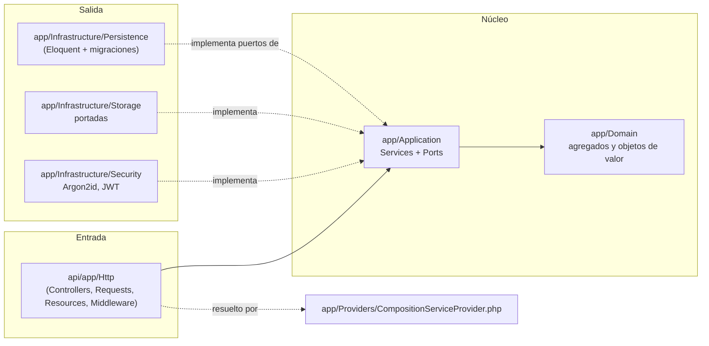
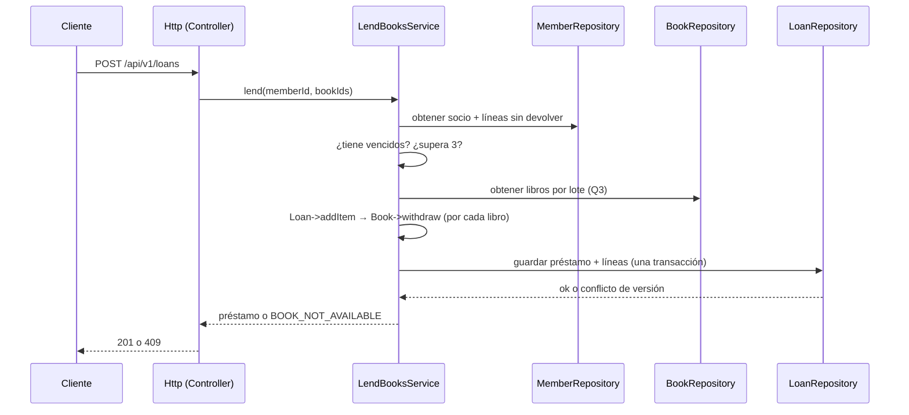

# Arquitectura hexagonal en Laravel — Manager Library

La forma del sistema es la **misma** que la de [`../spec-python/architecture.md`](../spec-python/architecture.md):
arquitectura **hexagonal** (puertos y adaptadores). Lo único que cambia es el lenguaje y el framework;
las **reglas de dependencia** son, literalmente, los **Artículos I, II y III** de
[`../spec-python/constitution.md`](../spec-python/constitution.md), y aquí se demuestra cómo cada uno
se cumple en la estructura real de `api/`.

> Esta es la traducción del Artículo I, II y III a Laravel. El negocio (agregados, invariantes,
> modelo de datos, contrato) no se redefine aquí: vive en `spec.md`, `data-model.md` y
> `api-contract.md` del spec original y se implementa sin cambios.

---

## 1. Los Artículos I, II y III, traducidos a Laravel

### Artículo I — El dominio no depende de nada → `api/app/Domain`

El original exige que `src/library/domain/` no importe ningún otro módulo del proyecto ni librerías
de terceros (ni SQLAlchemy, ni FastAPI, ni pydantic). En el reto, esto se traduce a:

- `api/app/Domain/` es **PHP puro**: agregados (`Book`, `Loan`, `LoanItem`, `Member`, `User`) y
  objetos de valor (`Isbn`, `Quantity`, `DocumentNumber`, `DateRange`) que **no** usan
  `Illuminate\*`. Nada de Eloquent, nada de facades, nada de HTTP, nada de validadores de Laravel.
- La verificación del original (`import-linter` + `tests/architecture/`) se traduce al test
  `DomainIsolationTest` (`T-06.3`): falla si `app/Domain` importa `Illuminate\*`.
- **Por qué importa:** permite probar las invariantes sin base de datos, sin servidor y sin
  contenedor, y cambiar de ORM sin tocar reglas.

### Artículo II — El núcleo declara sus puertos; el mundo los implementa → `api/app/Application`

El original exige que la capa de aplicación solo conozca el dominio y que todo lo externo se exprese
como un **puerto que ella misma define**, sin tipos de framework en las firmas. Traducción:

- `api/app/Application/Ports/` contiene **interfaces puras**: `BookRepository`, `LoanRepository`,
  `MemberRepository`, `UserRepository`, `ReportReader`, `Clock`, `PasswordHasher`, `TokenIssuer`,
  `CoverStorage`. Ninguna importa `Illuminate`.
- `api/app/Application/Services/` contiene **un servicio por caso de uso** (`LendBooksService`,
  `ReturnItemService`, `CreateBookService`, `SearchBooksService`, `OverdueService`,
  `MostBorrowedReportService`, `LoginService`, `CreateLibrarianService`, …). Los servicios dependen
  de los **puertos**, nunca de los adaptadores.
- La verificación del original (`application` no importa `adapters`, tests con fakes) se traduce al
  test `ApplicationIsolationTest` (`T-11.2`): falla si `app/Application` importa `app/Infrastructure`.
- **Por qué importa:** los casos de uso se prueban con fakes de los puertos, sin framework y sin base.

### Artículo III — Un único punto de composición → `api/app/Providers/CompositionServiceProvider.php`

El original reserva un solo módulo (`port_bindings.py`) para atar puerto↔adaptador. Traducción:

- `api/app/Providers/CompositionServiceProvider.php` es el **único** lugar donde un puerto se
  encuentra con su adaptador (bindings `interface → implementation` en el contenedor de Laravel).
- **Fuera de él no se instancia infraestructura.** Ninguna clase de `Infrastructure` se construye a
  mano en un servicio o controlador.
- La verificación se traduce al test `CompositionIsolationTest` (`T-17.1`): ninguna instanciación de
  un adaptador fuera del provider.

---

## 2. Capas y dependencias



Las flechas de dependencia apuntan **hacia adentro**. El dominio no conoce a nadie; la aplicación
solo conoce al dominio y declara sus puertos; los adaptadores implementan esos puertos; y el
**único punto de composición** (`CompositionServiceProvider`) es el que ve las dos mitades —igual que
`bootstrap` en el original.

## 3. Estructura de carpetas (idéntica al §3 del plan maestro)

```text
api/app/
├── Domain/                  # PHP puro: agregados y objetos de valor (sin Illuminate)
├── Application/
│   ├── Ports/               # interfaces puras (BookRepository, LoanRepository, MemberRepository,
│   │                        # UserRepository, ReportReader, Clock, PasswordHasher, TokenIssuer, CoverStorage)
│   └── Services/            # un servicio por caso de uso
├── Infrastructure/
│   ├── Persistence/         # modelos Eloquent + repositorios (implementan puertos)
│   ├── Security/            # Argon2id, JWT
│   └── Storage/             # CoverStorage en disco
├── Http/                    # Controllers, Requests, Resources, Middleware
└── Providers/
    └── CompositionServiceProvider.php   # ÚNICO punto de composición
api/database/migrations/     # TODO el DDL + semilla de las 5 categorías
api/routes/api.php           # /api/v1
```

## 4. Agregados

| Raíz | Contiene | Invariantes que defiende |
|---|---|---|
| `Book` | `Isbn`, copias totales y disponibles, baja lógica | disponibles entre 0 y total; total ≥ 1; título no vacío |
| `Loan` | colección de `LoanItem` | 1 a 3 líneas; sin libro repetido; vencimiento a 14 días; inmutable salvo devolución |
| `Member` | documento | documento obligatorio y único |
| `User` | rol, hash | nombre normalizado; rol en (`admin`, `librarian`) |

`Loan->addItem()` llama a `Book->withdraw()` antes de añadir la línea: descontar el ejemplar y crear
la línea son **una sola operación**. `Loan->returnItem()` llama a `Book->restock()` una sola vez por
línea.

## 5. Flujo: registrar un préstamo



El repositorio (`Infrastructure/Persistence`) es quien conoce Eloquent y PostgreSQL; el servicio solo
habla de puertos y de objetos de dominio.

## 6. Qué no cambia al traducir

- El **contrato HTTP** ([`../spec-python/api-contract.md`](../spec-python/api-contract.md)): base
  `/api/v1`, `snake_case`, UUID como texto, fechas ISO-8601 UTC con `Z`, cuerpo de error único
  `{code, message, details}` y la tabla de códigos de estado.
- El **modelo de datos** ([`../spec-python/data-model.md`](../spec-python/data-model.md)): seis
  tablas en el esquema `library`, sin `DEFAULT`, con las FKs, índices y `CHECK` descritos.
- Las **decisiones de arquitectura** del `adr/` original, traducidas en [`adr/`](adr/):
  propiedad del esquema (ADR-RL-001), concurrencia optimista (ADR-RL-002), baja lógica (ADR-RL-003),
  reporte agregado y congelado (ADR-RL-004) y punto único de composición (ADR-RL-005).

## 7. Errores

El dominio y la aplicación lanzan errores propios (`BookNotAvailable`, `MemberHasOverdue`,
`MemberLimitExceeded`, `ItemAlreadyReturned`, …). **Solo** el adaptador HTTP los traduce al cuerpo
único y al código de estado del contrato. Un error de framework (o una traza, o SQL) nunca llega al
cliente.

## 8. Qué no hay

Sin eventos, sin colas, sin caché, sin microservicios, sin multi-tenencia —igual que el original. Se
añaden si un requisito lo pide, no antes.
